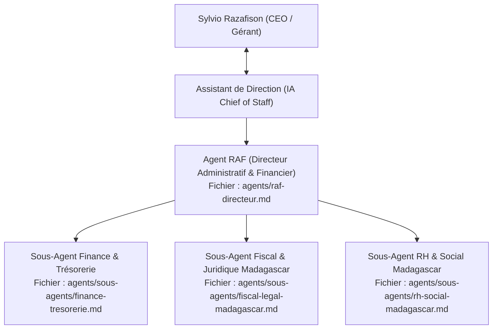

# Hub des Agents IA de GRAFIKALY SARL

Bienvenue dans le centre névralgique des agents de l'entreprise **GRAFIKALY SARL**.
L'ensemble des agents opère sous la supervision de l'**Assistant de Direction (IA Chief of Staff)** et sous l'autorité décisionnelle exclusive de **M. Sylvio Razafison (CEO)**.

---

## 1. Cartographie des Agents du Pôle Administration & Finance

---

## 2. Rôles et Fichiers de Définition

| Agent | Rôle | Niveau | Fichier de définition |
| :--- | :--- | :--- | :--- |
| **Agent RAF** | Directeur Administratif & Financier | Cadre / Manager | [`agents/raf-directeur.md`](file:///c:/Users/sylvi/DEV/Pilotage%20Entreprise/agents/raf-directeur.md) |
| **Sous-Agent Finance** | Gestion de trésorerie, facturation B2B et double journal | Opérationnel | [`agents/sous-agents/finance-tresorerie.md`](file:///c:/Users/sylvi/DEV/Pilotage%20Entreprise/agents/sous-agents/finance-tresorerie.md) |
| **Sous-Agent Fiscal & Légal** | Échéances DGI Madagascar, conformité SARL, NIF/STAT | Opérationnel | [`agents/sous-agents/fiscal-legal-madagascar.md`](file:///c:/Users/sylvi/DEV/Pilotage%20Entreprise/agents/sous-agents/fiscal-legal-madagascar.md) |
| **Sous-Agent RH & Social** | Conventions de stage, CNaPS, santé OSTIE, paie | Opérationnel | [`agents/sous-agents/rh-social-madagascar.md`](file:///c:/Users/sylvi/DEV/Pilotage%20Entreprise/agents/sous-agents/rh-social-madagascar.md) |

---

## 3. Règle d'Or de l'Autonomie Encadrée
- Tout agent IA prépare les dossiers, calcule les indicateurs, rédige les documents aux normes légales malgaches et propose des recommandations claires.
- **Aucun document officiel engageant** (facture fiscale émise, convention de stage, déclaration DGI, virement bancaire) n'est transmis à un tiers sans l'approbation explicite ("GO") du CEO.
