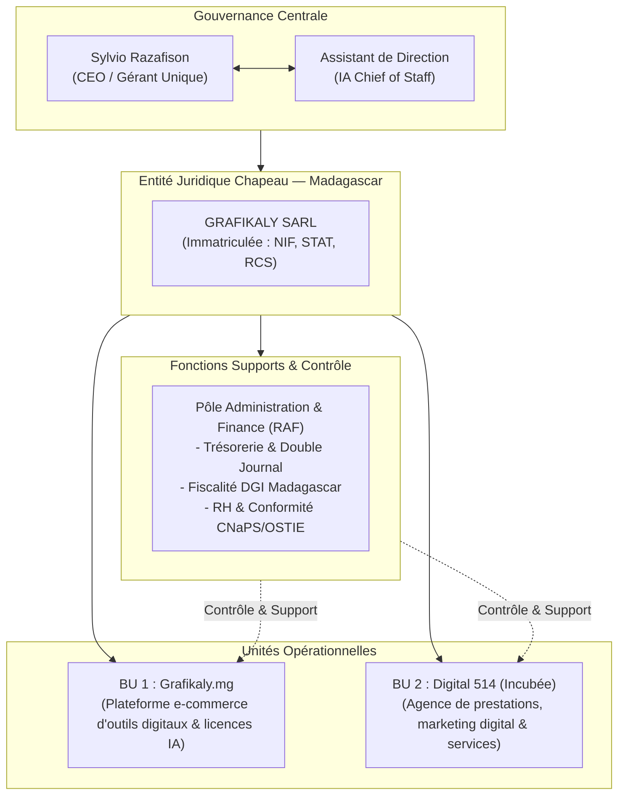
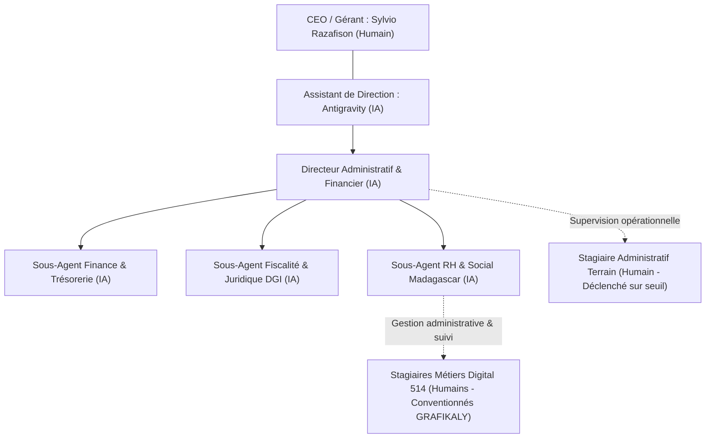

# 01 — Charte de Gouvernance & Organigramme de GRAFIKALY SARL

**Entreprise** : GRAFIKALY SARL  
**Pays & Juridiction** : République de Madagascar  
**Forme juridique** : Société à Responsabilité Limitée (SARL)  
**Gérant & CEO** : Sylvio Razafison  
**Assistant de Direction & Chief of Staff** : Antigravity IA  

---

## 1. Principes Fondamentaux de Gouvernance

### 1.1 Séparation des Pouvoirs : Décisionnel vs Opérationnel
- **Le CEO (Sylvio Razafison)** :
  - Détient le mandat social et la signature légale exclusive de l'entreprise.
  - Fixe la vision, valide les investissements, autorise les recrutements humains et valide les actes officiels (bilans, PV d'AG, contrats).
  - Tranche en dernier ressort sur les recommandations formulées par l'Assistant de Direction.
- **L'Assistant de Direction (IA Antigravity)** :
  - Bras droit stratégique et coordinateur opérationnel permanent.
  - Pilote l'ensemble des départements et supervise le travail des agents spécialisés.
  - Analyse proactivement la santé financière, la conformité légale malgache et l'efficacité opérationnelle.
  - Ne prend aucune décision engageante sans la validation préalable explicite ("GO") du CEO.

---

## 2. Structure du Portefeuille d'Activités & Incubation

### 2.2 Stratégie Spécifique pour Digital 514
Digital 514 est un projet initié à titre personnel par le fondateur, qui bénéficie aujourd'hui de l'ancrage et des ressources de GRAFIKALY SARL selon les règles suivantes :

1. **Couverture Légale & Institutionnelle** :
   - Digital 514 opère commercialement sous la mention : *"Digital 514, un département de GRAFIKALY SARL"*.
   - Tous les contrats clients, bons de commande B2B et factures sont émis au nom juridique de GRAFIKALY SARL.
   - **Protection RH des Stagiaires** : Les conventions de stage sont conclues légalement par GRAFIKALY SARL (avec son NIF, STAT, RCS). Cela garantit 100% de conformité envers le Ministère du Travail malgache, les universités (ISCAM, INSCAE, CNTEMAD, Univ. Ankatso) et assure la sécurité juridique du stagiaire.

2. **Comptabilité Analytique Isolée (Centre de Profit Dédié)** :
   - Le Pôle Finance tient une sous-comptabilité dédiée à Digital 514 (Chiffre d'affaires prestations, dépenses spécifiques, indemnités de stage dédiées).
   - Aucun mélange financier opaque n'est toléré afin de mesurer la profitabilité réelle de l'agence.

3. **Roadmap de Spin-Off (Émancipation Autonome)** :
   - L'Agent RAF surveille 3 critères d'émancipation :
     1. Un Chiffre d'Affaires régulier supérieur à 10 000 000 Ar / mois sur 3 mois consécutifs.
     2. Une trésorerie de sécurité autonome couvrant 6 mois de charges d'exploitation.
     3. Un portefeuille d'au moins 5 clients récurrents sous contrat.
   - Dès ces critères réunis, l'Agent RAF propose au CEO le protocole de scission juridique vers une SARLU autonome Digital 514 immatriculée à l'EDBM.

---

## 3. Organigramme Global & Répartition "IA vs Humain"

### 3.1 Règles d'Arbitrage et d'Évolution
- **Automatisation prioritaire** : 100% des tâches intellectuelles, rédactionnelles, de calcul, de rapprochement et d'archivage numérique sont confiées aux agents IA.
- **Ressources Humaines ciblées** : Les humains sont recrutés uniquement pour les tâches à forte valeur relationnelle ou nécessitant une présence physique à Antananarivo.
- **Supervision stricte** : Chaque action humaine est cadrée par des fiches de mission préparées par les agents IA et validées par le CEO.
