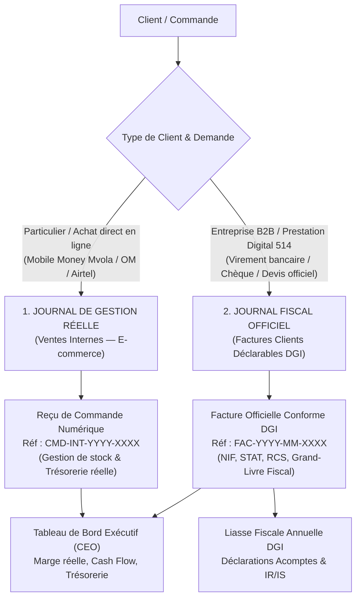

# 03 — Procédure Opérationnelle du Double Journal Comptable

**Contexte** : GRAFIKALY SARL opère à la fois une activité e-commerce de proximité (abonnements, licences logicielles et outils IA vendus principalement à des particuliers via Mobile Money) et une activité de services / B2B (prestations Digital 514, commandes d'entreprises locales exigeant des factures conformes à la DGI).  
**Objectif** : Piloter rigoureusement 100 % de la rentabilité réelle de l'entreprise tout en maintenant une comptabilité officielle parfaitement conforme aux normes de la Direction Générale des Impôts de Madagascar.

---

## 1. Vue d'Ensemble des Deux Flux

---

## 2. Spécifications du Journal 1 : Ventes Internes (E-commerce B2C)

### 2.1 Périmètre & Déclenchement
- **Commandes concernées** : Achats de licences, slots et abonnements numériques sur `grafikaly.mg` réalisés par des utilisateurs particuliers sans numéro NIF/STAT professionnel.
- **Canal de paiement** : Mvola, Orange Money, Airtel Money directs ou caisse espèces.
- **Référence documentaire** : Préfixe `CMD-INT-[Année]-[Numéro]`, par exemple `CMD-INT-2026-00412`.

### 2.2 Propriétés du document émis
- **Intitulé** : *« Reçu de commande et confirmation d'activation »*.
- **Contenu** : Détail de l'outil (ex: Canva Pro 1 an, CapCut Pro), identifiants d'accès ou instructions d'invitation, montant payé en Ariary, date et référence de transaction Mobile Money.
- **Mention explicite** : *« Reçu interne de livraison numérique — Non destiné aux déductions fiscales B2B »*.
- **Impact comptable** : Crédite le compte de trésorerie réelle (Mvola ou Caisse) et incrémente le compte de produit d'exploitation interne.

---

## 3. Spécifications du Journal 2 : Factures Officielles Déclarables (DGI B2B)

### 2.1 Périmètre & Déclenchement
- **Commandes concernées** :
  1. Toute prestation de services réalisée par la division **Digital 514** (création de site web, campagnes marketing, consulting, maintenance).
  2. Toute commande passée par une entreprise, ONG, association ou société commerciale nécessitant un justificatif fiscal pour ses propres charges déductibles.
- **Canal de paiement** : Virement bancaire sur compte professionnel GRAFIKALY SARL, chèque de société, ou Mvola Pro d'entreprise.
- **Référence documentaire** : Préfixe normalisé `FAC-[Année]-[Mois]-[Séquence]`, par exemple `FAC-2026-11-00045`.
  - **Règle absolue** : La séquence numérique est strictly continue et chronologique. Zéro trou de numérotation, zéro suppression de facture (toute annulation se fait obligatoirement par **Avoir** `AV-[Année]-[Mois]-[Séquence]`).

### 2.2 Mentions Légales Obligatoires (DGI Madagascar)
Toute facture émise dans ce journal contient impérativement :
1. Raison sociale : **GRAFIKALY SARL**
2. Adresse du siège social et contact officiel à Antananarivo
3. **NIF** (Numéro d'Identification Fiscale) et Centre fiscal gestionnaire
4. **STAT** (Numéro Statistique)
5. **RCS** (Numéro de Registre du Commerce et des Sociétés)
6. Identification complète du client (Raison sociale, NIF, STAT, adresse)
7. Date d'émission et date d'exigibilité du paiement
8. Description claire de la prestation ou marchandise avec quantité et prix unitaire en Ariary
9. Montant total en chiffres et mention obligatoire du montant en toutes lettres en Ariary (MGA)
10. Mode de règlement et coordonnées bancaires

---

## 4. Règles de Sécurité et de Rapprochement pour le Pôle Finance

1. **Étanchéité des Journaux** : Le Pôle Finance ne reporte jamais automatiquement une transaction du Journal 1 vers le Journal 2 sans émission formelle d'une facture validée.
2. **Double Tableau de Bord pour le CEO** :
   - **Vue Fiscale** : Chiffre d'affaires officiel déclaré, base d'imposition prévisionnelle IR/IS et provisions fiscales à constituer.
   - **Vue Réelle Consolidée** : Cash réel disponible en banque et portefeuilles mobiles, marge contributive de chaque produit et prévision de trésorerie nette.
3. **Imputation Analytique par Business Unit** :
   - Chaque ligne comptable des deux journaux est tagguée :
     - `BU: GRAFIKALY_ECOMMERCE`
     - ou `BU: DIGITAL_514`
   - Cela permet d'isoler en permanence le compte de résultat de Digital 514 pour préparer sa future autonomie.
