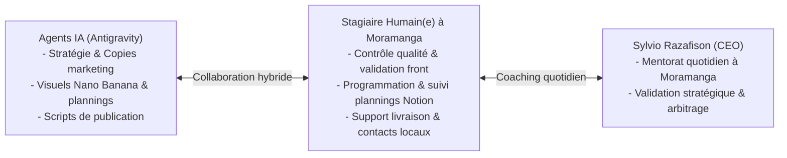

# 06 — Fiche de Poste & Cadrage : Stagiaire Opérationnel & Communication (Moramanga)

**Entreprise d'accueil légale** : GRAFIKALY SARL  
**Départements d'affectation** : Pôle Opérations & Communication (transversal Grafikaly.mg, Digital 514 & projet hyperlocal AIZÉ)  
**Lieu de stage** : Moramanga, Madagascar  
**Tuteur & Mentor** : M. Sylvio Razafison (CEO & Gérant)  
**Type de contrat** : Convention de Stage Tripartite (Étudiant en Gestion, Communication, Commerce ou Marketing)  
**Perspective d'évolution** : Tremplin direct vers une embauche en contrat à part entière (CDD/CDI) à l'issue du stage  

---

## 1. Raison d'Être du Poste & Modèle Hybride (IA + Humain)

L'entreprise opère avec un écosystème d'agents d'intelligence artificielle avancés qui conçoivent les stratégies, rédigent les textes, génèrent les visuels et automatisent les calculs.  
Cependant, l'exécution sur le terrain, le contrôle de cohérence, la programmation manuelle, le suivi des plannings et la relation de confiance exigent **une présence humaine rigoureuse et proactive**.

Le / La Stagiaire Opérationnel(le) et Communication est le **bras droit exécutif de Sylvio à Moramanga**. Il/elle travaille en binôme avec les agents IA pour s'assurer que tout ce qui est planifié est effectivement livré et publié à temps.

---

## 2. Missions Principales au Quotidien

### Volet A : Suivi Opérationnel & Livraisons (Grafikaly.mg)
- **Contrôle Front & Flux de Commandes** : Vérifier quotidiennement sur le site que le parcours d'achat fonctionne sans accroc (affichage des offres, calculs de panier, boutons de paiement Mobile Money).
- **Assistance aux Livraisons Numériques** : Suivre les commandes entrantes, vérifier que les identifiants ou invitations de licences (Canva, CapCut, Office 365, etc.) sont bien expédiés aux clients sans retard.
- **Détection des Blocages** : Alerter immédiatement Sylvio et l'Agent Finance dès qu'un client signale un problème d'accès ou un paiement en attente.

### Volet B : Communication & Marketing Digital (Grafikaly & Digital 514)
- **Gestion des Calendriers & Plannings Notion** : Tenir à jour les tableaux de bord éditoriaux (dates de publication, visuels prêts, légendes validées, statut publié/en attente).
- **Rattrapage des Retards Opérationnels** : Identifier les publications ou lancements en souffrance et orchestrer leur diffusion effective sur Facebook et les réseaux.
- **Assistance aux Publications Facebook** : Vérifier que les visuels générés par les agents IA s'affichent impeccablement, formater les textes et surveiller les commentaires entrants.

### Volet C : Ancrage & Déploiement Local du Projet AIZÉ (Moramanga)
- **Sous-projet de Digital 514** : Participer activement à la vie du projet AIZÉ (la plateforme hyperlocale de Moramanga).
- **Suivi des Fiches Commerçants** : Vérifier la mise à jour des informations locales (horaires, numéros de contact, nouveautés des commerces de Moramanga).
- **Ambassadeur Local** : Être le relais de terrain à Moramanga pour faire tester l'application aux commerçants et aux habitants.

---

## 3. Profil Recherché & Compétences Clés

### Ce que nous demandons (Indispensable) :
- **Localisation** : Résider obligatoirement à **Moramanga** (disponible pour travailler et apprendre aux côtés de Sylvio).
- **Aisance avec l'Outil Informatique** :
  - Maîtrise de l'ordinateur portable/bureau et de la navigation internet.
  - Familiarité avec les réseaux sociaux (Facebook, Messenger, WhatsApp).
  - Notions des outils bureautiques et digitaux (Google Sheets, Notion, boîte email).
- **Esprit d'Organisation & Rigueur** : Être méthodique, savoir tenir une to-do list et pointer ce qui est fait vs non fait.
- **Curiosité & Ouverture d'Esprit** : Motivation sincère pour apprendre à utiliser les outils d'Intelligence Artificielle modernes.

### Ce que nous NE demandons PAS :
- ❌ **Aucune compétence en programmation ou code web requise** (ce n'est pas un stage de développement).
- ❌ Pas besoin d'années d'expérience préalable : la volonté d'apprendre et l'assiduité sont prioritaires. Sylvio assure la formation complète sur place.

---

## 4. Package Financier : Indemnité de Base & Système de Commissions Motivantes

Pour allier sécurité légale du stage et forte motivation financière, la rémunération repose sur un **système hybride (Fixe + Variables sur résultats)** :

### 4.1 Indemnité Forfaitaire Mensuelle de Base
- Montant fixe versé chaque fin de mois pour couvrir les frais de transport et de subsistance à Moramanga : **entre 150 000 Ar et 250 000 Ar / mois** (selon niveau académique et horaires convenus dans la convention de stage).

### 4.2 Système de Commissions & Primes de Performance (Non plafonnées)
Le/la stagiaire perçoit des primes directes récompensant sa contribution active au chiffre d'affaires :

| Type de Résultat | Déclencheur & Règle d'Attribution | Montant / Taux de la Prime |
| :--- | :--- | :--- |
| **Vente Générée (Grafikaly)** | Client converti suite à une publication, une relance Messenger ou un suivi actif du stagiaire | **5 % à 10 %** du montant de la commande en Ariary |
| **Fidélisation Client** | Abonné réactivé ou renouvelé grâce à la relance personnalisée du stagiaire | **Prime forfaitaire de 2 000 Ar à 5 000 Ar** par abonnement sauvé |
| **Contrat Prestation Digital 514** | Contribution active à la signature d'un contrat de service ou création de site web | **5 % à 10 %** de la valeur nette du contrat (ex: 100 000 Ar à 200 000 Ar sur un contrat à 2M Ar) |
| **Objectif Clé AIZÉ atteint** | Validation et enrichissement de lots de fiches professionnelles vérifiées à Moramanga | **Prime d'étape forfaitaire** fixée par Sylvio |

---

## 5. Perspectives de Carrière post-stage

À l'issue de la période de stage (généralement 3 à 6 mois) :
1. Remise d'une **Attestation Officielle de Stage** signée par GRAFIKALY SARL avec lettre de recommandation d'excellence.
2. Si le bilan est concluant : **Proposition d'embauche directe en contrat à part entière (CDD/CDI)** au sein de GRAFIKALY SARL ou de la division Digital 514, avec statut de cadre opérationnel junior et salaire complet déclaré.
