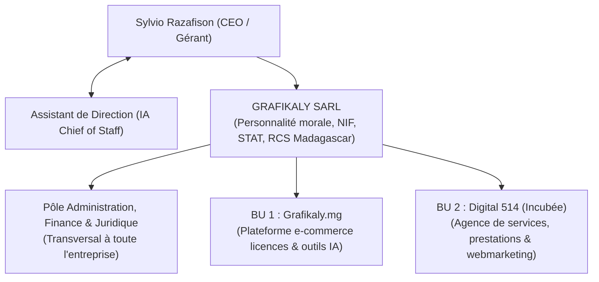
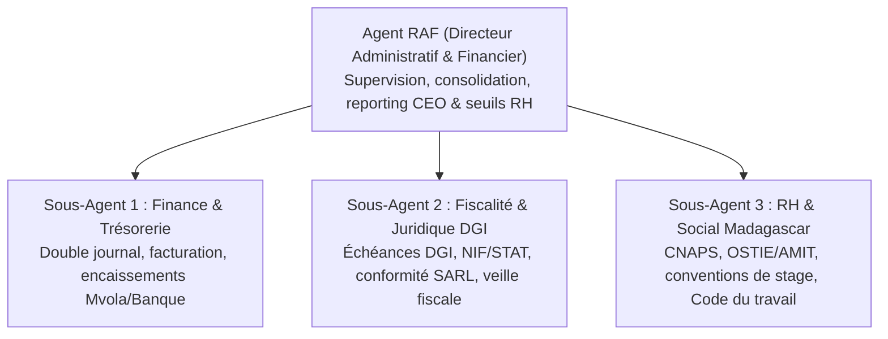

# Document de Conception : Structuration de GRAFIKALY SARL & Pôle Administration

**Date** : 04 Novembre 2026  
**Auteur** : Assistant de Direction (IA)  
**Décideur / CEO** : Sylvio Razafison  
**Entreprise** : GRAFIKALY SARL (Madagascar)  
**Statut** : Validé par le CEO via l'interview de cadrage `/grill-me`

---

## 1. Vision Stratégique & Gouvernance

### 1.1 Modèle de Gouvernance
- **CEO & Gérant Statutaire** : Sylvio Razafison. Il conserve la pleine autorité décisionnelle, arbitre les investissements, valide les recrutements humains et valide les actes juridiques.
- **Assistant de Direction / Chief of Staff (IA Antigravity)** : Bras droit opérationnel. Conseille, audite, modélise, structure les processus, conçoit les agents spécialisés et prépare les arbitrages pour le CEO.

### 1.2 Structure Juridique et Portefeuille de Marques

#### Stratégie d'incubation & protection de Digital 514
- **Constat** : Digital 514 est un projet stratégique initié par Sylvio, qui a vocation à être autonome mais ne dispose pas encore de personnalité morale propre ni de trésorerie autonome.
- **Solution validée** : Digital 514 est opéré en tant que **division / département interne de GRAFIKALY SARL**.
  - **Crédibilité & Légalité RH** : Les conventions de stage pour Digital 514 sont signées par GRAFIKALY SARL, avec la mention *"Division Digital 514"*, garantissant une validité juridique totale auprès des universités malgaches (ISCAM, INSCAE, CNTEMAD, Université d'Antananarivo, etc.).
  - **Comptabilité Analytique Isolée** : L'Agent Finance tient un centre de profit/coût distinct pour Digital 514 afin de mesurer sa rentabilité réelle.
  - **Protocole d'émancipation (Spin-off)** : Dès que Digital 514 génère une trésorerie autonome stable et un CA pérenne, l'Agent RAF déclenchera la création d'une entité juridique dédiée (SARLU à l'EDBM).

---

## 2. Architecture du Pôle Administration (Triptyque Spécialisé)

Le pôle est dirigé par un Agent Cadre, qui coordonne trois sous-agents experts :

### 2.1 Agent RAF (Responsable Administratif & Financier)
- **Rôle** : Pilote de l'administration générale de GRAFIKALY SARL.
- **Missions principales** :
  1. Consolider chaque semaine et chaque mois le tableau de bord de gestion pour le CEO.
  2. Alerter proactivement sur les échéances légales, fiscales et sociales.
  3. Calculer la rentabilité respective de Grafikaly.mg et de Digital 514.
  4. **Veilleur RH & Arbitre de Recrutement** : Surveille le volume d'opérations physiques terrain à Antananarivo et déclenche l'alerte de recrutement d'un stagiaire administratif dès que le ROI est positif.

### 2.2 Sous-Agent 1 : Finance & Trésorerie (Double Journal)
- **Rôle** : Maîtrise des flux financiers réels et déclarables.
- **Principe du Double Journal** :
  - **Journal Ventes Internes (Gestion Réelle B2C)** : Commandes directes automatisées du site `grafikaly.mg` payées via Mobile Money / agrégateur sans demande de facture avec NIF/STAT. Permet de piloter la marge brute réelle, le cash flow et les coûts logiciels.
  - **Journal Ventes Officielles (Factures Clients DGI B2B)** : Factures proforma et définitives émises pour les entreprises clientes (ex: prestations Digital 514, commandes B2B de licences), avec numérotation séquentielle stricte, mentions légales obligatoires (NIF, STAT, RCS) et conformité fiscale.
- **Gestion de Trésorerie** : Suivi des soldes Mvola Pro, Orange Money, comptes bancaires (BNI, BMOI, Société Générale, etc.) et de la caisse espèces.

### 2.3 Sous-Agent 2 : Fiscalité & Juridique Madagascar
- **Rôle** : Sécurisation légale et conformité aux règles de la Direction Générale des Impôts (DGI) de Madagascar.
- **Périmètre** :
  - Calendrier fiscal malgache : déclarations périodiques, acomptes provisionnels (IR / IS), droit de communication, état récapitulatif des achats et ventes.
  - Documentation sociétaire : PV d'Assemblées Générales Ordinaires (approbation des comptes annuels), conservation des registres légaux, mise à jour des coordonnées EDBM / Centre fiscal.

### 2.4 Sous-Agent 3 : RH & Social Madagascar
- **Rôle** : Gestion des talents, de la conformité sociale et du recrutement.
- **Périmètre légal malgache** :
  - **Conventions de Stage** : Conformes aux normes universitaires et au droit malgache (durée maximale, gratification/indemnité de stage, encadrement pédagogique, délivrance de l'attestation de fin de stage).
  - **Cotisations Sociales Salariés** :
    - **CNaPS** (Caisse Nationale de Prévoyance Sociale) : Cotisation patronale de **13 %** + cotisation salariale de **1 %** (plafonnée à 8 fois le SMIG en vigueur).
    - **Organisme Sanitaire Interentreprises** (OSTIE, AMIT, FUNHREUMA...) : Cotisation patronale de **5 %** + cotisation salariale de **1 %**.
  - **Registres obligatoires** : Registre du personnel, fiches de paie conformes aux déductions sociales malgaches.

---

## 3. Matrice d'Arbitrage "Agent IA vs Humain"

| Type de Mission | Opérateur Recommandé | Justification & Cadre |
| :--- | :--- | :--- |
| **Génération des devis, factures & contrats** | 🤖 Sous-Agent Finance / RH | 100% automatisable, instantané, zéro erreur de calcul |
| **Tenue des journaux de trésorerie & calculs fiscaux** | 🤖 Sous-Agent Finance & Fiscal | Calcul précis selon règles malgaches, gain de temps total |
| **Démarches physiques à Antananarivo** (Dépôt EDBM, centre fiscal, retrait chéquiers, certification) | 👤 Stagiaire Administratif Humain | Nécessite présence physique sur place à Antananarivo |
| **Dépôt des chèques & retraits bancaires** | 👤 CEO ou Stagiaire mandaté | Manipulation de moyens de paiement physiques |
| **Production des visuels & livrables web Digital 514** | 🤖 Agents IA + 👤 Stagiaire Design/Web | Synergie IA pour la vitesse + humain pour l'ajustement fin |

---

## 4. Livrables et Structuration du Workspace `Pilotage Entreprise`

1. **`agents/`** : Fiches de mission opérationnelles des 4 agents (RAF, Finance, Fiscal-Légal, RH).
2. **`docs/administration/`** :
   - `01-charte-gouvernance-organigramme.md`
   - `02-cadre-juridique-et-fiscal-madagascar.md`
   - `03-procedure-double-journal-comptable.md`
   - `04-guide-social-cnaps-ostie-stages.md`
   - `05-modele-convention-stage-madagascar.md`
3. **`scripts/` & `tests/`** :
   - Simulateur de charges sociales et de bulletins de paie malgaches (CNaPS + OSTIE + IRSA).
   - Simulateur de seuil d'opportunité de recrutement d'un stagiaire.
   - Outil de génération de numérotation séquentielle et de modèles de facturation à double journal.
